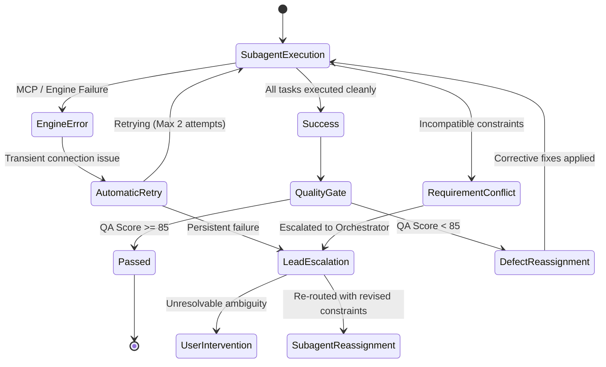

# Multi-Agent Communication Flow & Data Contracts

## 1. Communication Architecture

All agent interactions follow standardized asynchronous and synchronous messaging protocols. Subagents never write ad-hoc unstructured messages; they pass structured data envelopes containing inputs, outputs, canvas references, and defect logs.

```
       [User / Main Agent Prompt]
                   │
                   ▼
       +───────────────────────+
       │   lead-orchestrator   │
       +───────────────────────+
         │                   ▲
         │ Task Envelope     │ Result Envelope
         ▼                   │
       +───────────────────────+
       │   Specialized Agent   │
       +───────────────────────+
         │                   ▲
         │ Canvas Mutation   │ Inspection Result
         ▼                   │
       +───────────────────────+
       │ FigCraft MCP Server   │
       │ (Attach / Headless)   │
       +───────────────────────+
```

---

## 2. Standardized Message Envelopes

### A. Task Dispatch Envelope (Orchestrator -> Subagent)
Dispatched by `lead-orchestrator` when delegating work:

```json
{
  "taskId": "TASK-2026-004",
  "assignedAgent": "ui-architect",
  "phase": "STRUCTURAL_LAYOUT",
  "dependencies": ["TASK-2026-001 (Tokens Created)"],
  "inputs": {
    "viewport": { "preset": "Desktop", "width": 1440, "height": 900 },
    "targetFrameName": "Screen/Dashboard/Analytics",
    "tokenCollectionId": "VariableCollectionId:tokens/core",
    "contentSeed": {
      "domain": "Fintech / Cloud Infrastructure",
      "metrics": ["$142,850.00 ARR", "+24.2% Growth", "99.98% SLA"]
    },
    "requirements": [
      "12-column grid container (1200px max width)",
      "4-card KPI metric row with tabular numbers",
      "5-state matrix coverage (Ideal, Empty, Skeleton, Error, Stress)"
    ]
  },
  "constraints": {
    "xOffset": 80,
    "concentricRadii": true,
    "zeroEmoji": true,
    "zeroLoremIpsum": true
  }
}
```

### B. Execution Result Envelope (Subagent -> Orchestrator)
Returned upon task completion:

```json
{
  "taskId": "TASK-2026-004",
  "originatingAgent": "ui-architect",
  "status": "COMPLETED",
  "createdNodes": [
    { "id": "12:45", "name": "Screen/Dashboard/Analytics", "type": "FRAME" },
    { "id": "12:88", "name": "Section/KPI-Grid", "type": "FRAME" }
  ],
  "consumedTokens": ["color/surface/card", "color/brand/primary", "spacing/16"],
  "visualProof": {
    "screenshotPath": "d:/Figma Agent/FinalOut/screenshots/task-2026-004.png",
    "dimensions": { "width": 1440, "height": 1024 }
  },
  "warnings": [],
  "handoffTarget": "interaction-motion-engineer"
}
```

### C. QA Defect Log Envelope (QA Auditor / Judge -> Orchestrator)
Issued when a quality gate fails:

```json
{
  "auditId": "AUDIT-2026-012",
  "auditor": "visual-qa-auditor",
  "verdict": "FAIL",
  "score": 78,
  "threshold": 85,
  "defects": [
    {
      "severity": "CRITICAL",
      "category": "Optical Craft",
      "nodeId": "12:94",
      "nodeName": "Card/Metric/Billing",
      "issue": "Concentric radius violated: outer card has radius 16px with padding 8px, but inner button has radius 16px (pinched corner). Expected inner radius: 8px.",
      "remediationAgent": "ui-architect"
    },
    {
      "severity": "MAJOR",
      "category": "Color Contrast",
      "nodeId": "12:102",
      "nodeName": "Text/Subtitle/Muted",
      "issue": "Text contrast ratio is 3.1:1 (#71717A on #18181B). Fails WCAG AA minimum 4.5:1.",
      "remediationAgent": "design-system-engineer"
    }
  ]
}
```

---

## 3. Synchronous vs. Asynchronous Handoff Protocols

| Interaction Type | Mode | Mechanism | Safety Measure |
|---|---|---|---|
| **Intake to Foundations** | Synchronous | `lead-orchestrator` blocks downstream UI until `design-system-engineer` commits tokens. | Prevents hardcoded literal styling. |
| **Icons & Illustrations** | Asynchronous Parallel | `vector-graphics-specialist` fetches icons in parallel while `ui-architect` builds layout frames. | UI architect uses placeholder auto-layout frames that are swapped upon asset completion. |
| **Layout to Interactivity** | Synchronous | `interaction-motion-engineer` receives exact node IDs only after `ui-architect` commits the layer tree. | Eliminates broken node references in prototype links. |
| **Canvas Inspection & QA** | Synchronous | `visual-qa-auditor` captures live `screenshot` only when canvas writes have settled. | Prevents race conditions with pending `batch` operations. |
| **Code Generation** | Asynchronous | `frontend-engineer` reads static frame tree and variables without modifying canvas. | Zero side-effects on design document. |
| **Asset Export** | Asynchronous | `asset-exporter` exports multi-resolution PNG/SVG/PDF files to disk. | Runs without blocking main conversation thread. |

---

## 4. Error Propagation & Escalation Routes


