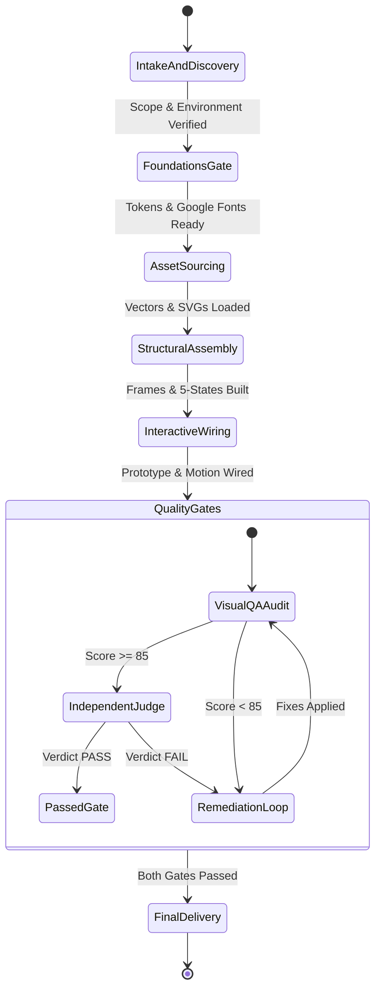

# Core Orchestrator Specification & Lifecycle Engine

## 1. Role Overview & Mission

The **Lead Orchestrator** is the central governing intelligence of the FigCraft Multi-Agent System. Its mission is to translate high-level user prompts, reference images, and existing codebases into structured technical specifications, assemble the optimal subagent squad, schedule task dependencies without deadlocks, and enforce strict delivery quality gates.

---

## 2. The 6-Phase Orchestration State Machine

---

## 3. Detailed Phase Execution Protocols

### Phase 1: Intake & Discovery
1. **Environment Verification:**
   - Detect running FigCraft instances using `scripts/ensure-figcraft.ps1` or check port `7979` / `47800`.
   - If not running, launch in attach mode (`--control 7979`) or fallback to headless session.
   - Load project `.figcraft` document using `figcraft/open_file` or initialize a new canvas.
2. **Input Classification:**
   - **Target Platform:** Mobile (iOS/Android), Desktop Web, SaaS Dashboard, Whiteboard, or Diagram.
   - **Execution Mode:** Green-field design, reference reconstruction, or design-to-code implementation.
   - **Framework Target:** React, Next.js, Vue, SwiftUI, Flutter, or pure Figma/FigCraft asset.
3. **Reference Manifest Creation:**
   - Map every supplied reference image to a distinct screen, overlay, or responsive state.
   - Extract primary colors, typography styles, layout density, and interactive affordances.

### Phase 2: Foundations Gate
1. Dispatch `design-system-engineer`:
   - Initialize token collections (`Color`, `Spacing`, `Elevation`, `Radius`).
   - Define Light and Dark mode variable values.
   - Audit fonts via `file.fontReport` and download required Google Fonts via `font.download`.
2. **Gate Validation:** Verify that `variable.list` returns non-empty collections before proceeding.

### Phase 3: Asset Sourcing & Illustration
1. Dispatch `vector-graphics-specialist`:
   - Identify all required UI icons; query Iconify API for single-family SVG paths (`lucide`, `tabler`, `ph`).
   - Author any required mascots, badges, or curved graphics in SVG and import via `file.import`.
2. **Gate Validation:** Verify zero emoji characters used as UI icons.

### Phase 4: Structural Assembly & Optical Polish
1. Dispatch `ui-architect` (for Web/Desktop) or `mobile-ui-specialist` (for iOS/Android):
   - Create frames using official hardware presets (`Desktop 1440`, `iPhone 16`, `Android Compact`).
   - Enforce an 80px horizontal gap between adjacent top-level screen frames.
   - Build auto-layout containers (`layout`, `gap`, `padding`, `sizingH`, `sizingV`).
   - Implement the 5-State Matrix: Ideal, Empty (with onboarding CTA), Skeleton loading, Error, and Stress overflow.
   - Apply concentric border radii ($R_{outer} = R_{inner} + P$) and dark mode surface luminance stepping.
   - Populate with realistic domain microcopy; eliminate all `Lorem Ipsum` and placeholder text.

### Phase 5: Interactive Wiring & Motion
1. Dispatch `interaction-motion-engineer`:
   - Wire screen-to-screen navigation via `proto.action.add`.
   - Wire modal dialogs, bottom sheets, and dropdowns as overlays with scrim backdrops.
   - Configure smart animate curves (100-150ms micro-interactions, 160-200ms spatial transitions, exit 25% faster than enter).

### Phase 6: Dual Quality Gates & Delivery
1. **Gate A: 100-Point Design Critique (`visual-qa-auditor`)**:
   - Capture live canvas `screenshot`.
   - Audit across Visual Hierarchy, Layout Geometry, Optical Craft, Authenticity, and Microcopy.
   - Minimum passing threshold: **85/100 points** with zero critical defects.
2. **Gate B: Independent Reference Judge (`independent-acceptance-judge`)**:
   - Compare rendered screenshot directly against source reference images.
   - Verify export tiling integrity using `scripts/check_tiling.py`.
   - Must return formal `PASS` verdict.
3. **Remediation Loop:** If either gate fails, pinpoint issues are returned to the originating subagent. Once resolved, the QA phase re-executes.
4. **Handoff & Delivery:**
   - `frontend-engineer` generates production component code and Code Connect bindings.
   - `asset-exporter` exports PNG/SVG/PDF assets and DTCG/Tailwind tokens.
   - Persist document state via `figcraft/save_file`.
